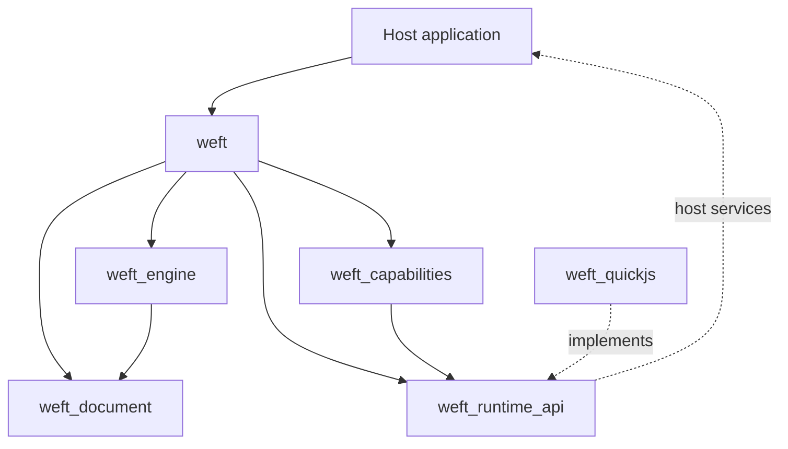

# 总体架构

## 1. 设计目标

Weft 将输入视为一种受控内容格式，而不是完整 Web 平台。核心由不可变文档、原生布局与单一渲染表面组成，JavaScript 是可拆卸的独立安全域。

优先级为：内容正确性、选择稳定性、安全恢复、性能、扩展能力。

## 2. 包依赖



规则：

- 外部 AST、QuickJS C 类型和宿主特权对象不得跨包泄漏。
- 引擎不知道具体 JS 后端；后端不知道布局和 RenderObject。
- 引擎不持有网络客户端；图片通过宿主 `WeftImageResolver` 解析，布局只接收已解码图像。
- 能力模块通过描述和调用消息交互，不读取引擎内部状态。
- 公开包负责编排，不承载底层解析或布局算法。

## 3. 内容管线

目标管线为：

```text
输入 HTML/CSS
  → 策略化规范化
  → 容错解析适配
  → 紧凑不可变 DocumentSnapshot
  → 计算样式与盒树
  → LayoutFragment
  → 分块 Picture / 命中与语义索引
```

当前复用 Dart `html`、`csslib` 的解析能力，但仅存在于适配层。内部节点使用稳定 `NodeId`，生成不可变 `WeftElement`/`WeftText` 树和结构化 `WeftStyleSheet`，外部不暴露完整 DOM。

阶段 1A 已实现规范化、节点树、结构化 CSS、计算样式和基础静态布局。快照可编码为规范 JSON（`WeftDocumentJson`，format+version 门禁，ADR 0034）：服务端规范化一次、客户端解码消费，一致性由 `conformance/normalization/` 固化向量逐字节约束。当前尚未引入独立盒树与通用 Fragment 层；布局直接遍历不可变节点并生成绘制命令。图片 Float 通过共享排除区和逐行文本测量交付（ADR 0011），表格采用整体两遍布局；流式追加会缓存 body 顶层块输出并复用未变前缀，变化区之后的形状相同块平移复用（ADR 0023/0046），但不等同于通用 Fragment 树。分块 `ui.Picture`、命中索引和单表面 Semantics 树均已实现（ADR 0024）；WeftView 的简单文档使用连续前缀测量与可见块物化，未测后缀仅估算滚动高度（ADR 0025）。

## 4. 布局与渲染

采用约束到 Fragment 的布局契约，按 Block、Inline、Table 和 Float 格式化上下文组织。缓存键至少包含内容版本、约束、字体、DPR 和文本缩放。

- Float 通过纵向区间的左右排除区计算逐行可用空间。
- 表格采用固定布局和两遍 min/max-content 自动布局。
- CJK 使用 Unicode 断行候选叠加可配置禁则表。
- `TextShaper` 隔离 Flutter 文本整形能力，最终行按实际断点整形。
- 单一 `RenderWeftSurface` 负责绘制、命中、选择和语义，不逐节点创建 Widget。
- 按 body 顶层块缓存 `ui.Picture`，仅绘制可见块；流式追加保留命令实例与几何均未变的前缀 Picture，选择覆盖层独立重绘。

阶段 1A 的 `RenderWeftSurface` 已执行真实布局与绘制：

- 块级内容按行叠放，支持 CSS 2.1 相邻、父子与空块 margin 折叠、padding、背景色、块级宽度约束、`box-sizing` 和 solid 边框。
- 行内内容由跨样式文本片段组成，经 `TextPainter` 完成空白折叠、换行、对齐和多行绘制；行高按 CSS 半行距分配（`TextLeadingDistribution.even`），固定字体下与 Chromium 的块级几何误差小于 0.5px。
- 列表标记单独绘制，不进入正文选择文本。
- 链接显示文本在布局后按字符范围查询行盒，生成跨行命中矩形；命中由单一表面解析，宿主通过 `onLinkTap` 决定导航。
- `RenderWeftSurface` 手动组装 SemanticsNode：文档树与文本索引提供阅读顺序，布局命令提供矩形，链接动作与选区更新走同一宿主通路；屏外节点不参与绘制视口裁剪（ADR 0024）。标题片段输出 `headingLevel`，显式 `aria-live` 子树的叶子输出 `liveRegion`，有序列表 marker 使用 `ol start`/`li value`（ADR 0039）；不为 live region 创建额外容器。
- 图片是块级替换元素：由 `WeftImageResolver` 提供 `ImageProvider`，`RenderWeftSurface` 监听解码结果并在完成后触发布局失效；布局只接收已解码的 `ui.Image`。
- Float 使用共享的 `_FloatContext` 保存排除矩形。每个行盒按当前 `y` 查询左右可用边界，空间不足时下移到最近浮动底部；`clear` 将后续块级元素推到对应浮动下方。
- Float 环绕走逐行分行路径，每行单独生成 `TextPainter` 和链接矩形；无浮动内容仍使用整段文本布局，避免改变已验收的静态路径。
- 表格用槽位网格实现（ADR 0012）：`colspan/rowspan` 占位、两遍 min/max-content 列宽、行槽拉伸与中心线折叠边框；单元格通过强制宽度的 `layoutBlock` 复用全部块级行为。
- `WeftView` 使用内部 `SingleChildScrollView`；在简单文档中把 250px overscan 视窗传给 RenderWeftSurface，只物化可见顶层块，复杂文档和需要完整几何的 selection 走 canonical full。Semantics 直接在 lazy 结果上组装窗口化语义（ADR 0041），不再触发升级。
- 文本缩放来自 `MediaQuery`，背景和文本命令在单一表面内按顺序绘制。块级基方向来自 `dir` 属性（`auto` 经 first-strong 检测）或 CSS `direction`，驱动 TextPainter 方向与起始对齐、列表缩进/marker 镜像与 caret 行内首侧；`lang` 转为 TextPainter locale（缺省 `zh`），行内双向重排由 SkParagraph 承担（ADR 0042）。

绘制、命中、选择和 Semantics 已按各自契约实现；WeftView lazy 路径对简单块流按窗口物化，复杂块流回退完整布局。未测滚动高度是渐进估算；深跳与深 seed 由表面逐帧预算推进（每帧至多新测 32 个顶层块，ADR 0031），窗口外的尾部块保持估算。同快照的滚动 relayout 复用上一结果的节点 diff 结论、跨帧样式缓存与文本索引实例，不重建样式或逻辑文本；流式新快照的文本索引按块 diff 前缀增量重建（含 lazy 部分测量前缀，ADR 0048），未命中回退全量（ADR 0044）；变化区之后的形状相同块按共享垂直增量平移复用（plain 路径，id 经映射重写，ADR 0046）；头部插入/头删除轮的索引经反向 diff 后缀映射采用旧条目——globalStart 平移 + nodeId 重映射，接缝标志不符的子 fresh 走查（ADR 0051）；lazy 轮的准入结论与逐子估算按已证前缀沿用、只验证/重建后缀（ADR 0049），plain 复用块顶层样式成对沿用上一轮缓存（ADR 0050）。ADR 0036 进一步持有块流元数据与保守绘制区间索引，直接物化已测窗口、增量维护后缀估算；body 格式化空白保留在快照但不进入块流，Float 从已测排除区恢复。像素深跳测量期间，WeftView 可用宿主的 `lazySettlingBuilder` 覆盖视口，并通过 post-frame 的 `onLazySettlingChanged` / `WeftViewState.isLazySettling` 报告起止（ADR 0037）；引擎不绘制占位、不伪造未测量块。超高顶层块、表内行与图片解码资源仍不细分虚拟化。

## 5. 选择模型

逻辑选择目标是使用 `(NodeId, localUtf16Offset)` 持久锚点，快照内另建全局文本索引。布局结果只负责把锚点映射为视觉区域，不能成为文本内容的唯一来源。

块边界与 `<br>` 的换行语义由文档规范统一规定。复制从逻辑模型读取，布局更新后重映射选区；无法映射时安全清除，禁止越界保留。

当前已建立 `TextAnchor`/`TextSelectionRange` 值类型、渲染表面的选择失效入口和绘制层。布局时构建逻辑文本索引（ADR 0013）：每个文本节点一个条目、块边界与 `<br>` 产出换行、锚点无法映射时安全清除；流式新快照按块 diff 前缀增量重建（含 lazy 部分测量前缀，ADR 0048）、未命中回退全量（ADR 0044）。绘制命令携带 painter 文本到节点文本的 run 映射，`WeftLayoutResult.selectionRects/selectionText` 分别给出视觉矩形与复制文本，表面绘制半透明选区高亮。手势定位锚点已交付（ADR 0015/0019）：长按选词、拖拽扩展、点击放置 caret 与选区把手/复制按钮由视图层实现。

## 6. JavaScript 安全域（阶段 4 已交付，ADR 0033）

首个后端采用 QuickJS 2024-01-13 与 `dart:ffi`：源码 vendor 在 `packages/weft_quickjs/ios/Classes/native/quickjs/`，C 垫片 `weft_glue.c` 提供扁平 ABI（只有指针/整数跨界，JSON 是唯一编组格式），`QuickJsFfiSession` 负责会话生命周期。每文档独立 `JSRuntime`，同文档脚本顺序执行，不同文档不共享全局对象。

原生库来源按平台不同（ADR 0035）：桌面/CI 由 `tool/build_native.sh` 编出动态库；Android 由插件模块的 CMake 把同一批源码编成 `libweft_quickjs.so` 打进 APK；iOS 由 pod 把垫片静态编进 app image，Dart 用 `DynamicLibrary.process()` 解析符号。`librarySourceFor()` 统一分派，显式路径或 `WEFT_QUICKJS_LIBRARY` 仍可覆盖。

预算在原生层强制：墙钟由中断处理器 + 单调时钟 deadline 覆盖一切同步执行，内存走 `JS_SetMemoryLimit`，栈走 `JS_SetMaxStackSize`，微任务由任务泵计数封顶。单轮事件循环内的能力调用风暴有 4096 次上限，`settle()` 以 256 轮兜底。

JS 不获得节点、盒树或渲染对象。它只能通过 `__weftBridge`（返回 Promise）调用启用命名空间的能力模块；引导脚本只为启用能力安装 `weft.*`，网关按策略二次拒绝。恢复只重跑能力引导并保留 `(sessionId, sequence)` 审计：重投递的命令命中去重，网络副作用永不自动重放。

`QuickJsNativeAdapter` 委托边界保留给平台定制实现；引擎核心与编排层只依赖 `weft_runtime_api` 契约，FakeRuntime（`weft_runtime_fake`）与 QuickJS 通过 `weft_runtime_contract` 的同一契约套件。

## 7. 扩展点

| 扩展点 | 稳定契约 | 约束 |
|---|---|---|
| 自定义标签 | `WeftTagRenderer.layout → WeftTagLayout{height, ops, semanticsLabel}`，rect/text ops 由引擎钳制归属（ADR 0033） | 受信任 Dart 代码，不由 JS 注册；标签须同时在 `WeftNormalizer.customTags` 白名单 |
| 布局算法 | 目标为 `LayoutAlgorithm.layout` | 按 display 注册，遵守格式化上下文和失效规则 |
| JS 后端 | `JsRuntimeBackend/JsSession` | 必须通过同一后端契约与超限测试 |
| JS 能力 | `CapabilityDescriptor/CapabilityModule` + `CapabilityGateway` | 版本化 Schema，未启用在 JS 中不可见；编排见 ADR 0033 |
| 资源提供 | 目标为 `ResourceProvider` | URL 策略、取消、缓存和解码大小受控 |

目标扩展接口只有进入对应里程碑并经过契约测试后才进入代码，避免占位 API 固化错误抽象。

## 8. 回退路径（阶段 5 已交付示例，ADR 0034）

规范化器和控制器输出 `SupportReport`。不支持内容不得静默显示为“成功渲染”；宿主通过 `WeftView.fallbackBuilder` 选择 WebView 或专用库。

`example/weft_fallback` 是可运行回退示例：`decideWeftFallback` 纯函数把报告映射为三路决策——原生渲染（`canRender`）、`requiresWebView` → 宿主 WebView（示例内经 `WeftFallbackCoordinator` 注入 `webview_flutter`，宿主持有原始 HTML）、其余错误 → 诊断卡片；widget 测试用注入占位覆盖决策契约，不触平台通道。

核心包不依赖 `webview_flutter`，避免回退机制反向污染轻量引擎。发布与版本回退见 docs/release-runbook.md（快照格式版本门禁、统一版本号、回滚演练测试）。

## 9. 关键 ADR

- `0001`：采用 Dart Pub workspace。
- `0002`：采用单一渲染表面。
- `0003`：规范化后生成不可变快照。
- `0004`：QuickJS 隐藏在可替换 Runtime 接口后。
- `0005`：选择模型独立于布局。
- `0006`：不支持内容显式回退。
- `0007`：以 TextPainter 和直接布局交付阶段 1A，再逐步引入 Fragment 与分块缓存。
- `0008`：从布局文本行盒派生链接命中区域，不引入逐链接 Widget。
- `0009`：在布局阶段解析块级边框盒宽度，统合 box-sizing、padding、border 和约束。
- `0010`：实现 CSS 兼容的相邻/父子/空块 margin 折叠与半行距。
- `0011`：图片由宿主资源解析器提供，Float 使用共享排除区与逐行文本布局。
- `0012`：表格使用槽位网格与中心线折叠边框模型。
- `0013`：选择基于逻辑文本索引，锚点在内容变更后安全清除。
- `0033`：受限 JS 运行时（QuickJS FFI + 能力网关 + 恢复去重）与自定义标签扩展。
- `0034`：回退、硬化与发布——快照 JSON 线格式与一致性向量、种子化模糊测试、WebView 回退示例、版本兼容锚点与回滚演练、API 文档门禁。
- `0035`：QuickJS 移动平台构建——Android CMake 就地编译、iOS 静态链接与 dead-strip 锚点、按平台分派的加载器。
- `0036`：已测窗口索引直物化、增量后缀估算、格式化空白准入及滚动校正收敛；JNY-AL10 profile 四项设备标准已通过。
- `0037`：冷深跳 settling——宿主视口遮罩与 post-frame 状态信号，引擎不画占位、不改布局预算；未配置 builder 时保持空白渐进填充。
- `0038`：Flutter 3.35.5 兼容基线——Flutter 依赖包与示例统一收紧下限，纯 Dart 包保持 Dart 3.5；版本对齐到 0.7.0-dev.1，运行时行为不变。
- `0039`：语义补全——headingLevel、`aria-live` live region 与有序列表 `start`/`value` marker；规范化保留新属性并重新生成列表向量。
- `0040`：ARIA 基础——role 保守映射（button/link/img/heading/dialog/alert/status/presentation）、aria-hidden/label 与 aria-atomic 整组播报；修复 aria-label 接缝错位。
- `0041`：语义虚拟化——Semantics 不再触发 lazy→full 升级，在 lazy 结果上组装窗口化语义（物化窗口精确、band 内未物化块粗叶子、未测后缀滚动物化后出现）。
- `0042`：RTL 基础方向与语言属性——dir/lang 白名单、块级基方向（auto first-strong + CSS direction）、RTL 对齐/断行/列表镜像/caret 边缘、lang→locale（缺省 zh 零回归）。
- `0043`：增量布局画像——`tool/incremental_profile_test.dart` 分解流式轮成本（textIndex 56–81%、diff 近乎免费）与形态阶梯，方向选择的数据依据。
- `0044`：文本索引前缀复用——流式新快照按块 diff 前缀复用条目、只构建后缀（共享 walker + 每块 checkpoint + 尾 trim 还原），未命中回退全量。
- `0045`：逐行 probe 窗口化——Float 断行探测按「两行字符量起步、margin=16、翻倍至段尾」的窗口，fit 前缀单调保证断点不变；run 前缀表二分定位。
- `0046`：后缀平移——变化区之后形状相同的块按共享垂直增量平移复用，先序 id 经形状比较 + 映射重写；Float 守卫与 body 级 li 截断保等价。
- `0047`：「样式与状态跨快照」家族画像——E4 分解 lazy 流式轮（97–99% 为家族工作：全量索引 T 38–63%、准入样式 S 12–18%、估算残差）与样式表规模敏感性；决策 lazy O(change) 化三步走。
- `0048`：lazy 轮文本索引增量参与——门按内容纯函数论证放宽，lazy 部分窗口复用条目；配套修复 0044 的部分前缀尾 trim/drop 还原与前缀 checkpoint 播种（链式轮不再隔轮回退）。
- `0049`：lazy 准入估算前缀采用——diff 已证前缀沿用上一轮准入结论与 `_LazyChild` 逐子估算，只验证/重建后缀；provisional allowLazy 不合格重跑 plain 模式。
- `0050`：plain 走查样式跨快照采用——diff 已证顶层子成对种子化上一轮样式，复用轮与样式表规模脱钩。
- `0051`：k=0 头部插入索引条目平移——`buildFromSuffix` 接缝标志比对 + 逐子走查或采用，旧条目 globalStart 平移 + nodeId 重映射；head-insert 同机 A/B @1000 −60%。
- `0052`：将 vendored QuickJS 移入 `ios/Classes/native/`，修复 CocoaPods 绝对/父目录源路径不生效导致的 iOS 静态库空链接；桌面、Android、iOS 共享同一份源码。
