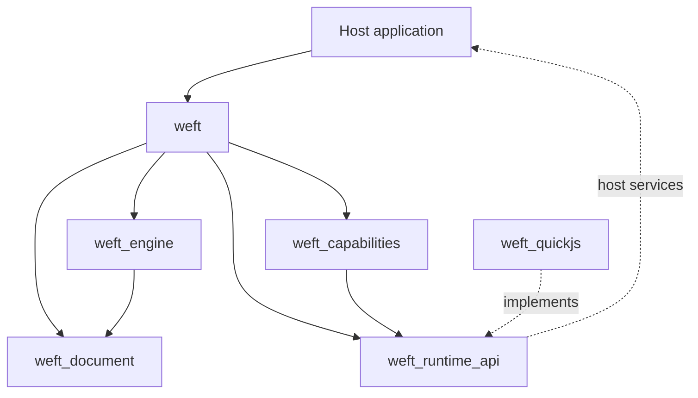

# 总体架构

## 1. 设计目标

Weft 将输入视为一种受控内容格式，而不是完整 Web 平台。核心由不可变文档、原生布局与单一渲染表面组成，JavaScript 是可拆卸的独立安全域。

优先级为：内容正确性、选择稳定性、安全恢复、性能、扩展能力。

## 2. 包依赖



规则：

- 外部 AST、QuickJS C 类型和宿主特权对象不得跨包泄漏。
- 引擎不知道具体 JS 后端；后端不知道布局和 RenderObject。
- 引擎不持有网络客户端；图片通过宿主 `WeftImageResolver` 解析，布局只接收已解码图像。
- 能力模块通过描述和调用消息交互，不读取引擎内部状态。
- 公开包负责编排，不承载底层解析或布局算法。

## 3. 内容管线

目标管线为：

```text
输入 HTML/CSS
  → 策略化规范化
  → 容错解析适配
  → 紧凑不可变 DocumentSnapshot
  → 计算样式与盒树
  → LayoutFragment
  → 分块 Picture / 命中与语义索引
```

当前复用 Dart `html`、`csslib` 的解析能力，但仅存在于适配层。内部节点使用稳定 `NodeId`，生成不可变 `WeftElement`/`WeftText` 树和结构化 `WeftStyleSheet`，外部不暴露完整 DOM。

阶段 1A 已实现规范化、节点树、结构化 CSS、计算样式和基础静态布局。当前尚未引入独立盒树与 Fragment 层；布局直接遍历不可变节点并生成绘制命令。图片 Float 已在该直接布局内通过共享排除区和逐行文本测量交付（见 ADR 0011），但表格、增量失效和完整格式化上下文仍需要独立 Fragment 结构。分块 `ui.Picture`、命中索引和语义树仍未实现。

## 4. 布局与渲染

采用约束到 Fragment 的布局契约，按 Block、Inline、Table 和 Float 格式化上下文组织。缓存键至少包含内容版本、约束、字体、DPR 和文本缩放。

- Float 通过纵向区间的左右排除区计算逐行可用空间。
- 表格采用固定布局和两遍 min/max-content 自动布局。
- CJK 使用 Unicode 断行候选叠加可配置禁则表。
- `TextShaper` 隔离 Flutter 文本整形能力，最终行按实际断点整形。
- 单一 `RenderWeftSurface` 负责绘制、命中、选择和语义，不逐节点创建 Widget。
- 后续按块缓存 `ui.Picture`，仅绘制可见块；选择覆盖层独立重绘。

阶段 1A 的 `RenderWeftSurface` 已执行真实布局与绘制：

- 块级内容按行叠放，支持 CSS 2.1 相邻、父子与空块 margin 折叠、padding、背景色、块级宽度约束、`box-sizing` 和 solid 边框。
- 行内内容由跨样式文本片段组成，经 `TextPainter` 完成空白折叠、换行、对齐和多行绘制；行高按 CSS 半行距分配（`TextLeadingDistribution.even`），固定字体下与 Chromium 的块级几何误差小于 0.5px。
- 列表标记单独绘制，不进入正文选择文本。
- 链接显示文本在布局后按字符范围查询行盒，生成跨行命中矩形；命中由单一表面解析，宿主通过 `onLinkTap` 决定导航。
- 图片是块级替换元素：由 `WeftImageResolver` 提供 `ImageProvider`，`RenderWeftSurface` 监听解码结果并在完成后触发布局失效；布局只接收已解码的 `ui.Image`。
- Float 使用共享的 `_FloatContext` 保存排除矩形。每个行盒按当前 `y` 查询左右可用边界，空间不足时下移到最近浮动底部；`clear` 将后续块级元素推到对应浮动下方。
- Float 环绕走逐行分行路径，每行单独生成 `TextPainter` 和链接矩形；无浮动内容仍使用整段文本布局，避免改变已验收的静态路径。
- `WeftView` 当前使用外部 `SingleChildScrollView` 提供滚动；后续将替换为引擎内部视口和分块缓存。
- 文本缩放来自 `MediaQuery`，背景和文本命令在单一表面内按顺序绘制。

当前是全量布局和全量绘制命令生成，尚未实现懒布局、视口命中、分块 Picture 或选择覆盖层。因此阶段 1A 只用于受控内容实验，长文档性能仍需后续门禁验证。

## 5. 选择模型

逻辑选择目标是使用 `(NodeId, localUtf16Offset)` 持久锚点，快照内另建全局文本索引。布局结果只负责把锚点映射为视觉区域，不能成为文本内容的唯一来源。

块边界与 `<br>` 的换行语义由文档规范统一规定。复制从逻辑模型读取，布局更新后重映射选区；无法映射时安全清除，禁止越界保留。

当前只建立了 `TextAnchor`/`TextSelectionRange` 值类型和渲染表面的选择失效入口，尚未生成全局文本索引、视觉选择区域、手势或复制行为。此能力仍按阶段 3 验收。

## 6. JavaScript 安全域

首个后端计划采用 QuickJS 与 `dart:ffi`。每文档独立 `JsContext`，同文档脚本顺序执行，不同文档不共享全局对象。工作池限制执行并发，异常 Runtime 不回收复用。

JS 不获得节点、盒树或渲染对象。它只能通过版本化能力桥调用状态、事件和网络模块。声明式状态绑定由 Dart 控制器转换为文档变更，进而触发局部失效。

当前包只定义 `JsRuntimeBackend`、`JsSession`、`QuickJsNativeAdapter` 等边界，没有原生执行实现。

## 7. 扩展点

| 扩展点 | 稳定契约 | 约束 |
|---|---|---|
| 自定义标签 | 目标为 `TagRenderer.layout/paint/hitTest/semantics` | 受信任 Dart 代码，不由 JS 注册绘制函数 |
| 布局算法 | 目标为 `LayoutAlgorithm.layout` | 按 display 注册，遵守格式化上下文和失效规则 |
| JS 后端 | `JsRuntimeBackend/JsSession` | 必须通过同一后端契约与超限测试 |
| JS 能力 | `CapabilityDescriptor/CapabilityModule` | 版本化 Schema，未装载不可见 |
| 资源提供 | 目标为 `ResourceProvider` | URL 策略、取消、缓存和解码大小受控 |

目标扩展接口只有进入对应里程碑并经过契约测试后才进入代码，避免占位 API 固化错误抽象。

## 8. 回退路径

规范化器和控制器输出 `SupportReport`。不支持内容不得静默显示为“成功渲染”；宿主通过 `WeftView.fallbackBuilder` 选择 WebView 或专用库。

核心包不依赖 `webview_flutter`，避免回退机制反向污染轻量引擎。

## 9. 关键 ADR

- `0001`：采用 Dart Pub workspace。
- `0002`：采用单一渲染表面。
- `0003`：规范化后生成不可变快照。
- `0004`：QuickJS 隐藏在可替换 Runtime 接口后。
- `0005`：选择模型独立于布局。
- `0006`：不支持内容显式回退。
- `0007`：以 TextPainter 和直接布局交付阶段 1A，再逐步引入 Fragment 与分块缓存。
- `0008`：从布局文本行盒派生链接命中区域，不引入逐链接 Widget。
- `0009`：在布局阶段解析块级边框盒宽度，统合 box-sizing、padding、border 和约束。
- `0010`：实现 CSS 兼容的相邻/父子/空块 margin 折叠与半行距。
- `0011`：图片由宿主资源解析器提供，Float 使用共享排除区与逐行文本布局。
